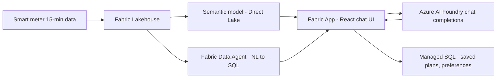

# EKZ Flexibility Assistant — Architecture, Agents, and Skills

## Architecture

| Layer | Role |
|---|---|
| Fabric Lakehouse | Interval consumption, tariff and price curves |
| Semantic model (Direct Lake) | Repeatable, read-only aggregates for UI and charts — [src/semanticModel.ts](rayfin-semantic-foundry-sample-main/src/semanticModel.ts) |
| Fabric Data Agent (MCP) | Open-ended natural-language data questions; writes the DAX |
| Azure AI Foundry | Conversational reasoning and explanation — [src/openai.ts](rayfin-semantic-foundry-sample-main/src/openai.ts) |
| `src/flex/` TypeScript | **All deterministic math** — profile, tariff, simulate, recommend, prompt |
| Managed SQL (Rayfin) | Per-user app state: saved plans, accepted actions, comfort preferences |

Split of responsibility: **the model explains, the code calculates.** Anything shown twice in the
product comes from the semantic model path so numbers cannot drift between sessions.

## Agents

### FlexCoach — [.github/agents/flex-coach.agent.md](.github/agents/flex-coach.agent.md)

Customer-facing persona. Read-only tools (`fabric-data-agent/*`, `search`, `read`), no code execution.

- **Does:** answers a household or SME customer in plain language about their consumption, EV, heat
  pump, tariff, savings, and grid impact.
- **Loop:** Discover (profile) → Explain (translate to money and comfort) → Decide (simulate) →
  Act (ranked next step). Never stops at "Explain".
- **Helps because:** it converts a dataset insight into a decision. The core frame it always uses —
  switching to the dynamic tariff and changing nothing costs the average customer **~5% more**,
  perfect shifting would save **~17%** — turns a confusing tariff question into a concrete
  behaviour question.
- **Guardrails:** no invented numbers, every figure has a stated period and assumption, comfort cost
  always named next to a saving, no sales pressure, no PII echoed, tool output treated as untrusted
  content.

### Flex Solution Builder — [.github/agents/flex-solution-builder.agent.md](.github/agents/flex-solution-builder.agent.md)

Developer agent. Full `edit` and `execute` tools, high reasoning effort.

- **Does:** implements the app — React chat UI, semantic model and data agent wiring, flexibility and
  tariff calculation modules, Foundry system prompt.
- **Helps because:** it treats the FlexCoach file as the product spec, so the built app and the
  assistant agree on tone and numbers. It enforces the non-negotiables mechanically: typed
  unit-tested math modules, secrets out of the repo, `npm run lint` / `build` / `test` before done.

## Skills

Shared knowledge both agents pull from.

| Skill | What it does | How it helps |
|---|---|---|
| `fabric-flex-data` | Verified schema, measures, units, query-and-verify protocol, missing-data fallbacks | Prevents wrong column names and unit errors (`Wh` not `kWh`, `TotalConsumtion_Wh` misspelled, `FixPricePerWh` is really CHF/kWh) — the root of most bad answers |
| `flexibility-profiling` | Splits the load curve into baseload / thermal / EV / boiler / residual; sizes kW, kWh/day, shift window, rebound | Establishes *what can actually move* before anything is promised. Labels every asset claim as inference — there is no submetering |
| `dynamic-tariff-simulation` | Prices a scenario between the do-nothing floor (~−5%) and the impossible ceiling (~+17%) using the full price stack | Attaches a defensible CHF number to shifting kWh. Any result outside the band is flagged as a bug, not a finding |
| `flexibility-recommendations` | Scores actions by value × effort × comfort × confidence; tiers them free → automation → contract → investment | Turns analysis into something doable this week, with the comfort cost stated and zero-comfort options dropped outright |
| `grid-signal-alignment` | Price, local feeder load, system peak, marginal CO2, balancing, ripple control — and where signals conflict | Answers "does this actually help?" honestly: modest individual claim, then the aggregate effect. Says plainly which signals are not measured yet |
| `flex-explainability` | Jargon translation table, kW-vs-kWh analogy, the four-part number disclosure, scepticism handling | Makes numbers trustworthy. A correct number nobody understands has zero value; false precision is treated as a trust bug |

## Supporting customization

| File | Purpose |
|---|---|
| [.github/instructions/flex-app.instructions.md](.github/instructions/flex-app.instructions.md) | Code rules, auto-applied to `src/**` |
| [.github/instructions/customer-copy.instructions.md](.github/instructions/customer-copy.instructions.md) | Tone and trust rules for any customer-facing text |
| [.github/skills/fabric-flex-data/references/semantic-model.md](.github/skills/fabric-flex-data/references/semantic-model.md) | Verified schema, measures, units, dataset facts |
| [.github/prompts/flex-conversation-eval.prompt.md](.github/prompts/flex-conversation-eval.prompt.md) | `/flex-conversation-eval` conversation quality harness |
