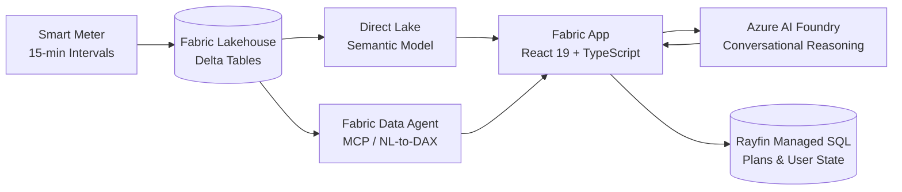

<div align="center">

# ⚡ VoltFlex AI
### Enterprise Smart-Grid Flexibility Copilot & Dynamic Tariff Simulation Engine

[](https://www.typescriptlang.org/)
[](https://react.dev/)
[](https://www.microsoft.com/en-us/microsoft-fabric)
[](https://azure.microsoft.com/en-us/products/ai-studio)
[](https://vitest.dev/)
[](#-security-privacy--zero-secret-architecture)

<p align="center">
  <b>A governed, multi-agent AI system translating 388,000 smart meter intervals into verifiable, comfort-preserving household flexibility.</b><br>
  <i>Built with Microsoft Fabric Direct Lake, Azure AI Foundry, Rayfin Managed SQL, and React 19.</i>
</p>

[🌐 View Interactive Showcase Page (showcase.html)](showcase.html) • [🏗️ Architecture Deep-Dive](#-system-architecture) • [🤖 Multi-Agent System](#-multi-agent-system--governance) • [🎯 Interview Talking Points](#-interview-deep-dive--architectural-tradeoffs)

---

</div>

## 💡 The Core Analytical Insight: "The Product is the Gap"

Real-world analysis of **144 customer meters across ~388,000 15-minute intervals over a Swiss winter month** revealed a counter-intuitive market reality:

<div align="center">

| Household Scenario | Economic Outcome | Real-World Feasibility |
|:---|:---:|:---|
| **Switch to dynamic tariff & change nothing** | <kbd><b>−5.0%</b></kbd> *(You pay MORE)* | ⚠️ **The Dynamic Tariff Trap** |
| **Realistic load shifting with comfort guardrails** | <kbd><b>+4.0% to +10.0%</b></kbd> *(Net Savings)* | ✅ **The VoltFlex Target Zone** |
| **Theoretical, physically impossible perfect shifting** | <kbd><b>+17.0%</b></kbd> *(Unreachable)* | ❌ **Theoretical Ceiling** |

</div>

> **Why do customers lose money by default?**  
> Typical household consumption peaks at **17:00** (~0.30 CHF/kWh)—the most expensive hour of the day. The cheapest hour, **03:00** (~0.20 CHF/kWh), sits at their lowest consumption trough. Switching tariffs alone penalizes the customer.  
> **VoltFlex AI does not sell a tariff—it empowers customers to capture the gap between −5% and +17% without sacrificing daily comfort.**

---

## 🏗️ System Architecture

VoltFlex enforces a strict engineering invariant: **The Code Calculates, The Model Explains.**



### Layered Separation of Concerns

<table>
  <thead>
    <tr>
      <th>Layer</th>
      <th>Technology</th>
      <th>Key Responsibility</th>
    </tr>
  </thead>
  <tbody>
    <tr>
      <td><b>Data Lakehouse</b></td>
      <td><code>Microsoft Fabric OneLake</code></td>
      <td>Stores 15-minute smart meter intervals, spot prices, and dynamic tariff curves in Delta Parquet.</td>
    </tr>
    <tr>
      <td><b>Semantic Model</b></td>
      <td><code>Direct Lake (TMDL)</code></td>
      <td>Delivers sub-second, read-only aggregations via Apache Arrow IPC with per-user Entra SSO (1–100 rows).</td>
    </tr>
    <tr>
      <td><b>Data Agent Tooling</b></td>
      <td><code>Fabric Data Agent (MCP)</code></td>
      <td>Translates ad-hoc natural language data questions into verified DAX queries.</td>
    </tr>
    <tr>
      <td><b>Deterministic Engine</b></td>
      <td><code>TypeScript (src/flex/)</code></td>
      <td>Executes 100% of mathematical calculations (baseload, tariffs, simulations, recommendation ranking).</td>
    </tr>
    <tr>
      <td><b>Conversational AI</b></td>
      <td><code>Azure AI Foundry (GPT-4o)</code></td>
      <td>Explains pre-calculated numbers using empathetic, non-technical plain language. Never calculates.</td>
    </tr>
    <tr>
      <td><b>User Persistence</b></td>
      <td><code>Rayfin Managed SQL</code></td>
      <td>Per-user isolated SQL storage for accepted actions, saved flexibility plans, and comfort limits.</td>
    </tr>
  </tbody>
</table>

---

## 🤖 Multi-Agent System & Governance

The platform uses two specialized agents configured in `.github/agents/`:

```
.github/
├── agents/
│   ├── flex-coach.agent.md             # Customer advisor persona (Read-only, strict guardrails)
│   └── flex-solution-builder.agent.md  # Autonomous software engineering agent (Full dev tools)
├── instructions/
│   ├── flex-app.instructions.md        # Code quality & unit-typed rules (Suffixed identifiers)
│   └── customer-copy.instructions.md   # Copy rules (Swiss conventions, B1 reading level)
└── prompts/
    └── flex-conversation-eval.prompt.md# 12-turn conversational benchmark harness
```

### 1. `FlexCoach` — Customer-Facing Copilot
- **Conversational Loop:** `Discover (Profile) → Explain (Context) → Decide (Simulate) → Act (Recommend)`
- **Core Rule:** *Never stop at Explain. A customer who understands but cannot act has gained nothing.*
- **Guardrails:**
  - Strict length limit: $\le 120$ words per response; exactly 1 question per turn.
  - Zero numerical hallucination: Every number must be injected from the `<<<GROUNDED_FACTS>>>` block.
  - Comfort cost mandatory: Every saving must state its comfort tradeoff in the same sentence.
  - Swiss conventions: Currency in CHF, rates in Rp./kWh, 24-hour clock, polite form (*Sie*).
  - Refuses ungrounded claims ($CO_2$ claims without verified emission factors, direct device actuation, peer comparison).

### 2. `Flex Solution Builder` — Developer Agent
- Software engineer agent that treats the `FlexCoach` persona as the product specification.
- Enforces unit-tested deterministic math modules, zero secrets in source code, and automated build gates.

---

## 🧠 The 6 Flexibility Domain Skills

Domain intelligence is modularized into 6 skills loaded via progressive disclosure:

<table>
  <thead>
    <tr>
      <th>Skill</th>
      <th>Core Question</th>
      <th>Technical Mechanism & Formula</th>
    </tr>
  </thead>
  <tbody>
    <tr>
      <td><code>fabric-flex-data</code></td>
      <td><i>"What is verified in the data?"</i></td>
      <td>5-step reason-then-query protocol with 6 data quality checks. Handles physical model quirks (<code>TotalConsumtion_Wh</code>, <code>FixPricePerWh</code>).</td>
    </tr>
    <tr>
      <td><code>flexibility-profiling</code></td>
      <td><i>"What can be shifted?"</i></td>
      <td>Disaggregates baseload, thermal, EV, and boiler loads. Computes Price Alignment Score: <code>1 - Σ(E·p) / Σ(E·p̄)</code> and Flexibility Score (0–100).</td>
    </tr>
    <tr>
      <td><code>dynamic-tariff-simulation</code></td>
      <td><i>"What is shifting worth?"</i></td>
      <td>Mathematical simulation bounded by floor (-5%) and ceiling (+17%). Includes thermal rebound & battery round-trip efficiency (~90%).</td>
    </tr>
    <tr>
      <td><code>flexibility-recommendations</code></td>
      <td><i>"What should I do first?"</i></td>
      <td>Multi-attribute ranking: <code>Score = Value × Effort × Comfort × Confidence</code>. Actions with 0 comfort are dropped. Max 3 actions.</td>
    </tr>
    <tr>
      <td><code>grid-signal-alignment</code></td>
      <td><i>"Does this actually help the grid?"</i></td>
      <td>Evaluates 6 grid signals (spot price, grid tariff, balancing power, local congestion, system peak, marginal CO₂). Prevents rebound herding.</td>
    </tr>
    <tr>
      <td><code>flex-explainability</code></td>
      <td><i>"How do we explain it simply?"</i></td>
      <td>Analogy engine (kW vs. kWh as flow vs. bucket size; 4-part numerical disclosures; transparent skepticism handling).</td>
    </tr>
  </tbody>
</table>

---

## 💻 Frontend Applications & Capabilities

### 1. Primary Fabric App ([`frontend/`](frontend/))
An enterprise React 19 application designed for native embedding within Microsoft Fabric:
- **`FlexCoach` Panel:** Streaming conversation with structured fact injection and zero arithmetic hallucination.
- **`Your Energy` Dashboard:** Visual breakdown of baseload, peak power, shiftable energy, and inferred assets.
- **`Agents & Skills` Diagnostic Panel:** Real-time visibility into active skills, confidence metrics, and intermediate calculation outputs.
- **`Model Data` Tab:** Portal-brokered Apache Arrow table viewer querying Direct Lake delta tables.
- **`Your Notes`:** User-isolated, multi-tenant CRUD notebook backed by Rayfin Managed SQL (`dbo.Notes`).

### 2. Interactive Gamification & Customer Journey ([`Data Agent Integration/frontend/app/`](Data%20Agent%20Integration/frontend/app/))
A standalone customer journey prototype with automated Playwright end-to-end tests:
- **4-Stage Customer Journey:** *My Electricity* (interval curves) $\rightarrow$ *My Opportunities* (ranked actions) $\rightarrow$ *Compare an Option* (scenario simulation) $\rightarrow$ *My Next Step* (action commitment).
- **Floating Energy Guide (`EnergyGuide.tsx`):** Context-aware floating copilot that answers questions and automatically navigates the UI to the relevant screen.
- **Interactive Cutaway House (`MomentumScene.tsx`):** Dynamic SVG house/apartment cutaway displaying verified appliances with animated energy particle flows.
- **Energy Momentum Story Layer:** 5-chapter gamified experience with illustrative demo coins (1 coin = 1 CHF saved) and an animated celebration wrap-up.
- **Flex XP Protocol:** Design specification for weekly commitments, habit formation, and squad cooperation.

---

## 🔒 Security, Privacy & Zero-Secret Architecture

1. **Volatile Memory Only:** Azure OpenAI API keys and tokens are held exclusively in React state memory. Never persisted to `localStorage`, `sessionStorage`, cookies, `.env`, or server logs.
2. **Immediate Session Teardown:** Changing endpoints, signing out, or closing the tab immediately aborts in-flight requests and clears memory references.
3. **Portal-Brokered Direct Lake Reads:** The frontend never handles master database credentials or raw SQL connection strings. Reads are brokered through Microsoft Fabric's native messaging bridge under per-user Entra SSO.
4. **Untrusted Data Isolation:** All data agent outputs and smart-meter readings are treated as untrusted data blocks delimited by `<<<GROUNDED_FACTS>>>`. Control characters and delimiter forgery attempts are stripped before prompt construction.


## 🚀 Quickstart & Verification

```powershell
# 1. Clone repository & install dependencies
git clone https://github.com/cweo/rayfin-semantic-foundry-sample.git
cd EKZ/frontend
npm ci --registry=https://registry.npmjs.org

# 2. Run unit tests & static analysis
npm run lint
npm run build
npm test

# 3. Start local development server
npm run dev
```

---

<div align="center">
  <sub>Developed for the EKZ Flexibility Initiative • Microsoft Fabric, Azure AI Foundry, TypeScript & React 19.</sub>
</div>
